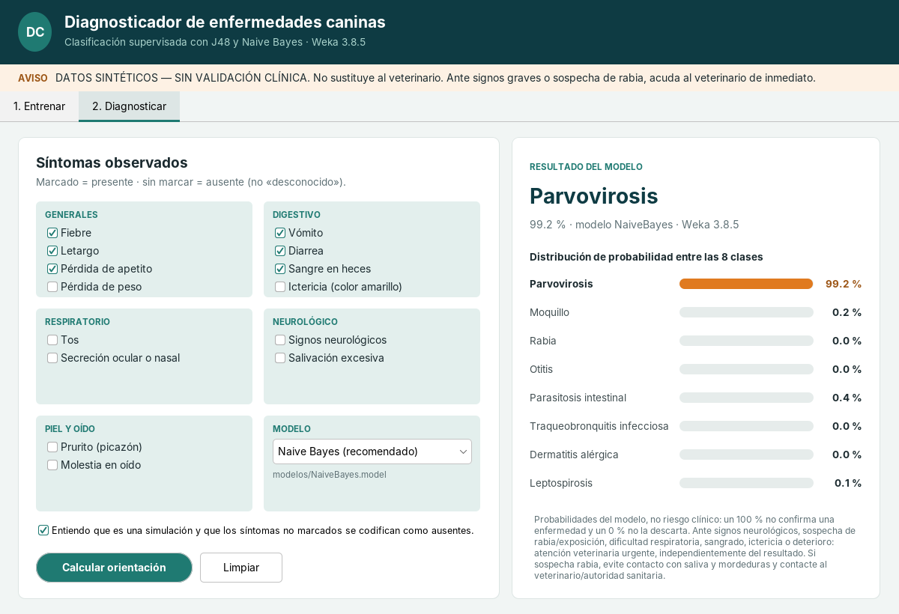

# Diagnosticador funcional de enfermedades caninas

**Proyecto académico completo · Java 11+ · Weka 3.8.5 · Swing · Maven**

> **Datos sintéticos, muestra pequeña, sin validación clínica.** La aplicación ilustra clasificación supervisada: no confirma ni descarta enfermedades, no prescribe y no sustituye al veterinario. Las probabilidades son del modelo, no riesgos clínicos. No incluye perros sanos ni todas las enfermedades posibles.

## 1. Dataset completo

[`dataset.arff`](dataset.arff) contiene **200 filas**, **15 síntomas binarios nominales `{0,1}`**, **8 enfermedades nominales** y **25 muestras por clase**. Todas las filas están incluidas. El orden de atributos y clases es un contrato verificado por el código. La documentación de tamaño, diccionario, perfiles y limitaciones está en [`docs/DATOS.md`](docs/DATOS.md).

## 2. Generador que produjo el ARFF

Código íntegro: [`DataGenerator.java`](src/main/java/edu/canino/DataGenerator.java), con metadatos compartidos en [`Schema.java`](src/main/java/edu/canino/Schema.java). Usa `java.util.Random`, semilla **20261127**, muestreo Bernoulli y barajado reproducible. No descarga datos. Las probabilidades son supuestos didácticos manuales, no estimaciones veterinarias.

```sh
java -Dfile.encoding=UTF-8 -jar entrega/diagnosticador-canino.jar generar dataset.arff
```

SHA-256 esperado del ARFF: `64d2ba7e29beb5ecd88934640822fe1e964f72681d668e60d4e897b16a938924`.

## 3. Experimento Java y resultados reales

Código íntegro: [`Experiment.java`](src/main/java/edu/canino/Experiment.java), [`Charts.java`](src/main/java/edu/canino/Charts.java), [`TrainingService.java`](src/main/java/edu/canino/TrainingService.java) y [`DataIO.java`](src/main/java/edu/canino/DataIO.java).

```sh
java -Dfile.encoding=UTF-8 -jar entrega/diagnosticador-canino.jar experimento dataset.arff resultados
```

CV **estratificada de 10 pliegues**, semilla **42**, particiones idénticas para ambos algoritmos; entrenamiento independiente en cada pliegue. Resultados sobre las 200 predicciones fuera de muestra:

| Algoritmo | Accuracy | Precisión macro | Recall macro | F1 macro |
|---|---:|---:|---:|---:|
| J48 | 70.00 % | 0.701221 | 0.700000 | 0.696176 |
| Naive Bayes | 83.00 % | 0.833654 | 0.830000 | 0.829347 |

El informe incluye la discusión del sesgo favorable a Naive Bayes, la confusión otitis/dermatitis y los falsos negativos de rabia. **No son estimaciones de rendimiento clínico.**

Resultados completos: [`resultados/metricas.md`](resultados/metricas.md). CSV de métricas globales y por clase, pliegues, asignación de filas, 400 predicciones con probabilidades, matrices de confusión y cinco gráficas SVG en [`resultados/`](resultados/). La consola imprime las métricas globales y todos los detalles se exportan a archivos.

Auditoría independiente opcional (Python 3, sin paquetes):

```sh
python3 scripts/verificar_resultados.py
```

## 4. Aplicación funcional y código completo

- [`pom.xml`](pom.xml): dependencia exacta `nz.ac.waikato.cms.weka:weka-stable:3.8.5`, compilación Java 11 y JAR con dependencias.
- [`src/main/java/edu/canino/`](src/main/java/edu/canino/): diez clases Java de producción, sin pseudocódigo.
- [`MainWindow.java`](src/main/java/edu/canino/MainWindow.java): Swing con pestañas de entrenamiento y orientación, 15 checkboxes y tareas en segundo plano.
- [`ModelBundle.java`](src/main/java/edu/canino/ModelBundle.java) y [`PredictionService.java`](src/main/java/edu/canino/PredictionService.java): serialización con cabecera, versión, hash y distribución entre las ocho clases.
- [`Main.java`](src/main/java/edu/canino/Main.java): comandos `generar`, `entrenar`, `experimento`, `diagnosticar`, `gui` y `ayuda`.
- [`entrega/diagnosticador-canino.jar`](entrega/diagnosticador-canino.jar): ejecutable incluido; no requiere Maven para usarlo.
- [`modelos/J48.model`](modelos/J48.model) y [`modelos/NaiveBayes.model`](modelos/NaiveBayes.model): modelos ya entrenados con las 200 filas. Sus representaciones legibles están junto a ellos.

**Seguridad:** cargue únicamente modelos locales de confianza. La deserialización Java puede ejecutar código de un archivo malicioso; comprobar el tipo después de leerlo no constituye un aislamiento de seguridad.

## 5. Informe completo redactado

[`docs/INFORME.md`](docs/INFORME.md): portada con marcadores de autor/institución, introducción, modelación formal, datos, revisión bibliográfica, arquitectura y diagrama, experimento con todas las tablas/gráficas, discusión, conclusiones, recomendaciones y referencias. No es solo un esquema.

## 6. Instrucciones paso a paso y lista de archivos

### A. Ejecutar la entrega sin compilar

1. Instale un **Java 11 o superior actualizado**, con Swing/escritorio para la interfaz. Verifique `java -version`. No se necesita Python para la app, los modelos ni los gráficos.
2. Descomprima `entrega/proyecto-completo.zip` en una carpeta de trabajo, si usa el paquete descargable. Si usa el repositorio, ya está listo. **Ejecute los comandos desde la raíz que contiene `dataset.arff` y `pom.xml`.**
3. Compruebe la ayuda:

```sh
java -Dfile.encoding=UTF-8 -jar entrega/diagnosticador-canino.jar ayuda
```

4. Entrene ambos modelos (reemplaza los `.model` de esa carpeta):

```sh
java -Dfile.encoding=UTF-8 -jar entrega/diagnosticador-canino.jar entrenar dataset.arff modelos
```

5. Abra Swing:

```sh
java -Dfile.encoding=UTF-8 -jar entrega/diagnosticador-canino.jar gui
```

En **Entrenar**, seleccione el ARFF y la carpeta de salida, pulse el botón y confirme. En **Diagnosticar**, elija el modelo en el selector (Naive Bayes, J48 u otro archivo `.model`), marque los síntomas, agrupados por sistema, acepte las limitaciones y pulse el botón. Cada cálculo carga el modelo seleccionado del disco y muestra la clase sugerida en una tarjeta y los ocho porcentajes como barras. El botón **Limpiar** desmarca todo. Marcado significa presente; desmarcado significa ausente, **no desconocido**. No se calcula con todos los checkboxes vacíos: no existe clase sano. Se muestran advertencias de urgencia con independencia de la clase predicha. El diálogo de entrenamiento no bloquea el hilo de la interfaz.

6. Alternativa en consola (también sirve en servidores sin pantalla):

```sh
java -Dfile.encoding=UTF-8 -jar entrega/diagnosticador-canino.jar diagnosticar modelos/NaiveBayes.model fiebre,vomito,diarrea,letargo,perdida_apetito,sangre_heces
```

Use nombres sin tildes del diccionario, separados por comas; no mencionados se codifican como 0. Un nombre desconocido produce error, no se ignora. No use la salida para decidir si un perro necesita atención.

### B. Compilar y reproducir todo desde las fuentes

Requisitos: **JDK 11+** (no solo JRE), **Maven 3.8+**, acceso a Maven Central la primera vez; escritorio si quiere Swing. `JAVA_HOME` debe apuntar al JDK. Los siguientes comandos Java/Maven también funcionan en PowerShell, desde la raíz.

```sh
java -version
mvn -version
mvn clean verify
java -Dfile.encoding=UTF-8 -jar target/diagnosticador-canino.jar generar dataset.arff
java -Dfile.encoding=UTF-8 -jar target/diagnosticador-canino.jar entrenar dataset.arff modelos
java -Dfile.encoding=UTF-8 -jar target/diagnosticador-canino.jar experimento dataset.arff resultados
java -Dfile.encoding=UTF-8 -jar target/diagnosticador-canino.jar gui
```

`mvn clean verify` compila, ejecuta las 12 pruebas JUnit y empaqueta con Shade. Generar es opcional: se incluye el ARFF exacto. Los tests comprueban su hash contra la versión reproducida. Los modelos finales se entrenan con las 200 filas **después/independientemente de** la evaluación CV; no se evalúa el modelo final sobre sus propias filas como si fuera generalización.

`mvn test` repite solo las pruebas. `python3 scripts/verificar_resultados.py` audita los CSV. `python3 scripts/actualizar_informe.py` regenera el informe desde la plantilla y los resultados; se niega si cambian las cifras de la discusión para evitar conclusiones desactualizadas. `python3 scripts/crear_entrega.py` vuelve a crear el ZIP con las fuentes y el JAR distribuido; después de recompilar, copie el nuevo JAR de `target/` a `entrega/` antes de empaquetar.

### C. Compatibilidad y validación efectivamente realizada

- **`mvn clean verify` ejecutado: BUILD SUCCESS, 12/12 pruebas** (JDK 21 con `release 11`). Registro: [`resultados/maven_verify.txt`](resultados/maven_verify.txt).
- Con el JAR de Maven se regeneró el ARFF (idéntico byte a byte), se reentrenaron los modelos y se repitió el experimento: los CSV y SVG coinciden exactamente con los de `resultados/`.
- **Swing probado con la ventana real** bajo pantalla virtual (Xvfb) con [`scripts/PruebaGui.java`](scripts/PruebaGui.java): marca síntomas, pulsa el botón y lee la clase y las 8 probabilidades. Registro: [`resultados/prueba_gui.txt`](resultados/prueba_gui.txt).
- Compatibilidad Java 11 comprobada anteriormente con ECJ `-11` y ejecución de las 12 pruebas en Java 11.0.9.1; las clases propias usan bytecode Java 11 (55).
- Pendiente: revisión manual de accesibilidad/teclado en un escritorio físico ([`docs/PRUEBAS.md`](docs/PRUEBAS.md)) y, por supuesto, cualquier validación clínica.



En Java moderno, Weka 3.8.5 puede requerir apertura reflectiva: ambos empaquetadores incluyen `Add-Opens: java.base/java.lang` en el manifiesto. Si ejecuta clases con `-cp` en lugar de `-jar`, añada `--add-opens=java.base/java.lang=ALL-UNNAMED`. No necesita este ajuste manual al usar los JAR indicados.

### D. Solución de problemas

- `java`/`mvn` no encontrados: instale y agregue JDK/Maven al PATH.
- Maven no descarga: revise red/proxy y acceso a Maven Central; el JAR incluido no necesita descargas.
- `Modelo no encontrado`: ejecute `entrenar` o examine un `.model` existente desde Swing.
- `ARFF incompatible`: restaure los nombres/orden nominal del contrato; los valores faltantes no están admitidos.
- `Swing requiere escritorio gráfico`: use CLI en servidor o ejecute el JAR en su computadora con entorno gráfico. Swing no es una aplicación web ni una previsualización del navegador.
- Modelo de otra versión: reentrene; no reutilice serializaciones ajenas ni archivos no confiables.
- Porcentajes 0 o 100: son redondeos/distribuciones sintéticas, **no descartan ni confirman enfermedad**.

Inventario detallado de archivos: [`docs/ARCHIVOS.md`](docs/ARCHIVOS.md). Licencia del código: [GPL-3.0](LICENSE); dependencias/procedencia en [`docs/TERCEROS.md`](docs/TERCEROS.md).

## 7. Calendario sugerido

[`docs/CALENDARIO.md`](docs/CALENDARIO.md) desarrolla **Propuesta → Datos → Experimento → Entrega final**, con tareas, productos y criterios de aceptación en cuatro semanas. Se separa lo ya completado en este proyecto de cualquier futura validación clínica.
