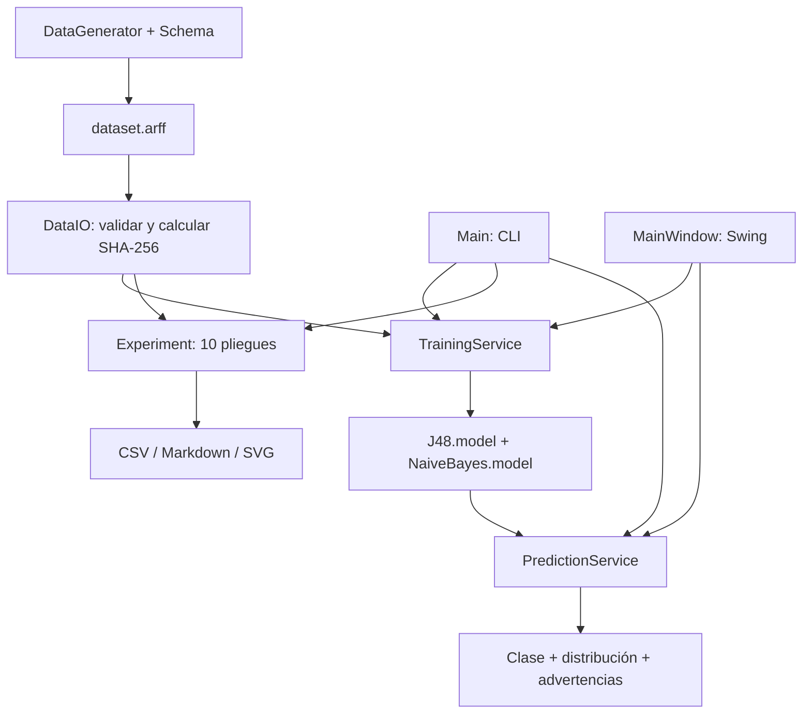
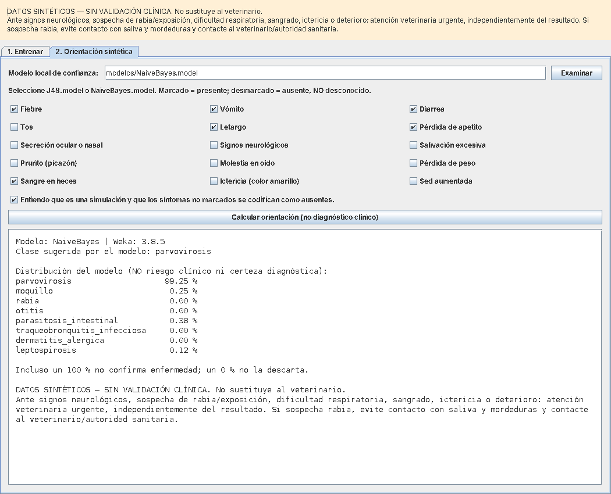
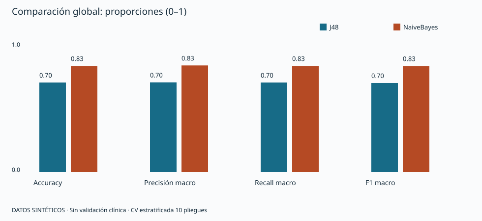
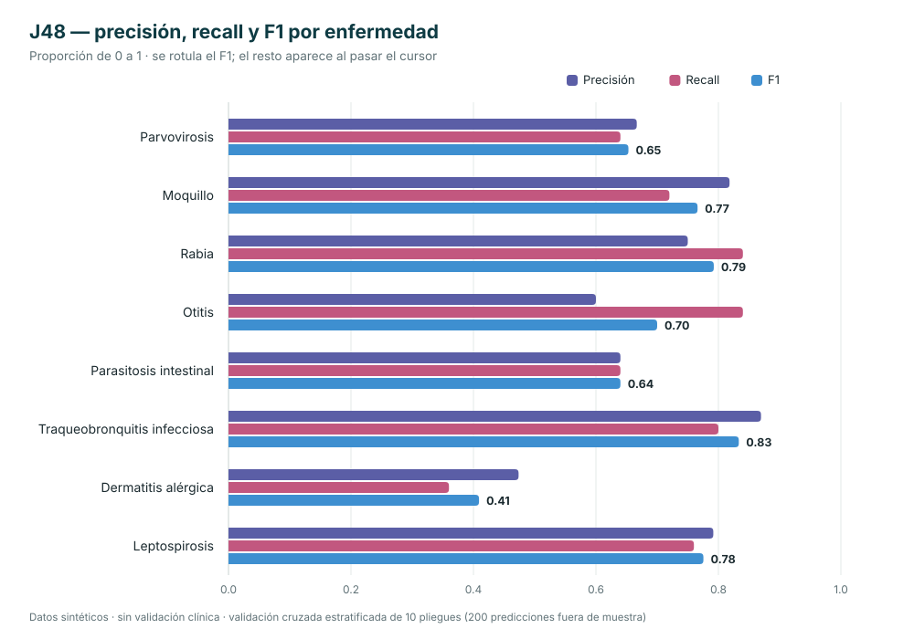
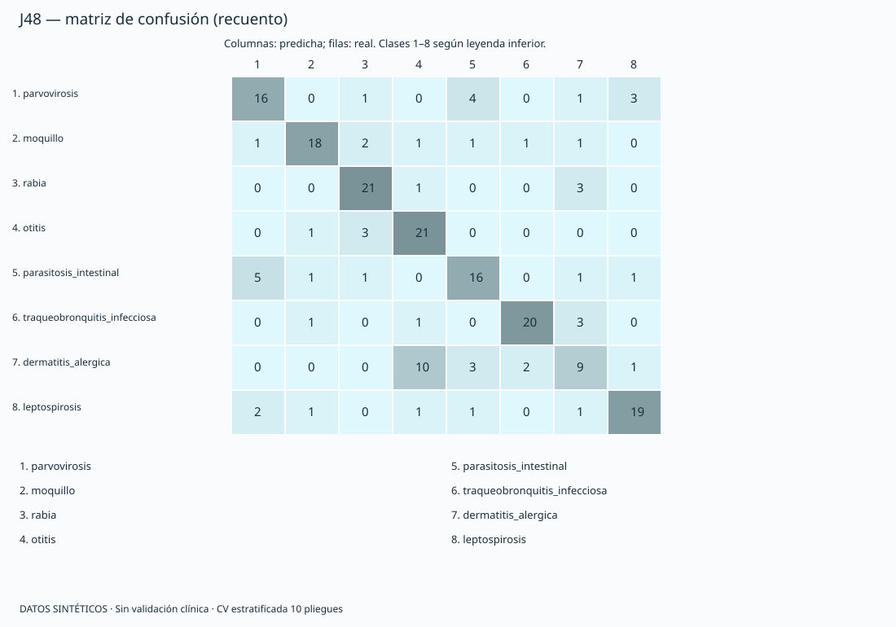
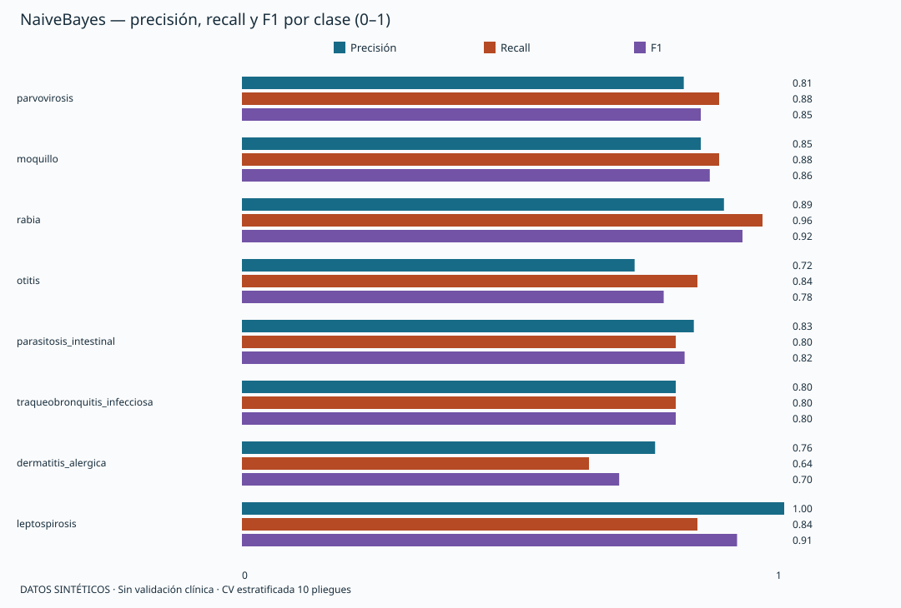
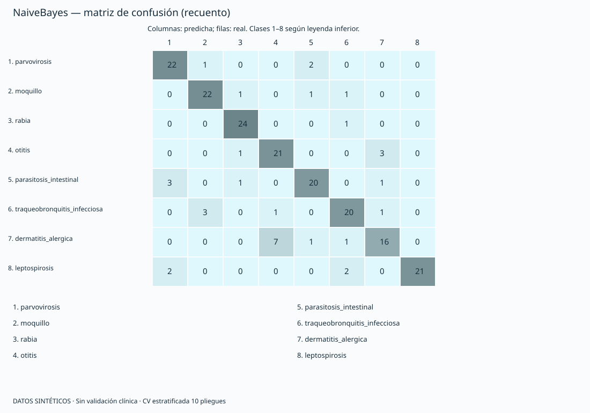

# Diagnosticador funcional de enfermedades caninas mediante aprendizaje supervisado

## 1. Portada

**Título:** Diagnosticador funcional de enfermedades caninas: comparación de J48 y Naive Bayes sobre datos sintéticos  
**Autor/a:** [NOMBRE DEL AUTOR/A]  
**Matrícula:** [MATRÍCULA]  
**Institución:** [INSTITUCIÓN]  
**Asignatura y grupo:** [ASIGNATURA / GRUPO]  
**Docente:** [NOMBRE DEL DOCENTE]  
**Fecha de entrega:** [FECHA]

**Naturaleza del trabajo:** prototipo académico reproducible. **Datos sintéticos; muestra pequeña; sin validación clínica. No sustituye al veterinario.** El término «diagnosticador» designa aquí un clasificador de patrones simulados, no un dispositivo médico ni una prueba diagnóstica.

## 2. Introducción

Los signos observables de enfermedades caninas se superponen: fiebre, vómito, diarrea o letargo no identifican por sí solos una etiología. En una evaluación real son necesarios historia clínica, vacunación, exploración, contexto epidemiológico y pruebas seleccionadas por un profesional. Un sistema que ignore estos factores puede proporcionar una respuesta aparentemente precisa y, sin embargo, equivocada. Por ello, el objetivo de este trabajo es demostrar una cadena de ingeniería y ciencia de datos verificable, no automatizar decisiones clínicas.

El papel concreto de la inteligencia artificial es aprender una función que relacione quince signos binarios con una de ocho etiquetas nominales. Se comparan un árbol de decisión J48 y Naive Bayes, implementados en Weka 3.8.5. Una interfaz Swing permite entrenar ambos modelos y explorar sus predicciones, mostrando la distribución completa entre clases y advertencias persistentes. No se recomiendan tratamientos ni se decide si puede posponerse una consulta.

El aporte es un proyecto íntegro: generador determinista, 200 registros ARFF, entrenamiento, serialización con contrato de atributos, validación cruzada, exportación de métricas y gráficos, aplicación, pruebas y documentación. Todas las cifras que se presentan proceden de ejecuciones del código entregado. Su alcance se restringe a recuperar regularidades introducidas por un generador artificial.

## 3. Desarrollo

### 3.1. Modelación del problema

El aprendizaje es **supervisado, multiclase y de etiqueta única**. Sean

\[
X\in\{0,1\}^{200\times15},\quad Y\in\mathcal C^{200},\quad
\mathcal C=\{\text{parvovirosis, moquillo, rabia, otitis, parasitosis intestinal, traqueobronquitis infecciosa, dermatitis alérgica, leptospirosis}\}.
\]

Cada fila representa un caso sintético y cada columna un signo. El valor 1 significa presencia y 0 ausencia. No existe una tercera categoría para «no observado»: un checkbox sin marcar se codifica como ausencia, limitación explícita de la interfaz. La salida es una clase nominal, no una escala de gravedad ni una combinación de diagnósticos. La función entrenada es \(\hat f:X_i\mapsto\hat y_i\), acompañada por un vector \(\hat p(c\mid X_i)\) con ocho componentes que suman uno. Se selecciona \(\arg\max_c \hat p(c\mid X_i)\); ante empates, Weka escoge la primera clase de máximo valor según el orden del ARFF.

En Weka los síntomas se declaran nominales `{0,1}` para que ambos algoritmos interpreten estados categóricos y no magnitudes continuas. La última columna se llama `enfermedad`; su índice se fija expresamente. Se comprueba tanto el nombre como el orden de todos los atributos y valores nominales antes de entrenar o cargar una cabecera serializada. Durante inferencia el valor de clase se deja **faltante**, nunca se introduce una etiqueta supuesta.

**Representación mediante árbol.** J48 es la implementación Weka de C4.5 [2]. Cada nodo interno prueba un atributo y cada arco corresponde a uno de sus valores. Una ruta raíz-hoja representa una conjunción de signos; la hoja almacena una decisión y frecuencias de clases. Por ejemplo, una ruta podría tener la forma «tos = 1, secreción = 1, signos neurológicos = 0 → etiqueta respiratoria»; este ejemplo describe la representación, no una regla veterinaria ni una afirmación sobre la estructura concreta aprendida. El árbol efectivo está completo en `modelos/J48.txt`. Se usa poda por confianza 0.25 y mínimo dos ejemplos por hoja, manteniendo las demás opciones predeterminadas.

**Representación bayesiana.** Naive Bayes factoriza

\[
\hat p(c\mid x)=\frac{\hat p(c)\prod_{j=1}^{15}\hat p(x_j\mid c)}{\sum_{c'\in\mathcal C}\hat p(c')\prod_{j=1}^{15}\hat p(x_j\mid c')}.
\]

Weka estima distribuciones nominales con suavizado. Se usan sus opciones predeterminadas, sin estimadores de densidad kernel ni discretización supervisada. La independencia condicional es una aproximación fuerte en medicina y coincide, deliberadamente como simplificación didáctica, con el generador empleado. Las distribuciones de ambos métodos **no están calibradas clínicamente**, y los prioris de clases balanceadas no reflejan prevalencias poblacionales.

### 3.2. Recolección de datos

No se recolectaron historias de pacientes ni datos personales. `DataGenerator.java` produce exactamente **25 observaciones de cada una de 8 clases: 200 filas y 16 atributos en total**, de los cuales 15 son predictores. El formato ARFF incluye relación, atributos nominales y todas las filas después de `@data`. El archivo ocupa pocos kilobytes y es legible tanto por Weka como por la aplicación. Los nombres sin tildes permiten usar los mismos identificadores en consola.

Se eligieron perfiles de signos compatibles de forma cualitativa con las descripciones clínicas de enfermedades infecciosas, gastrointestinales, dermatológicas y óticas de los textos veterinarios [4–6]. Parvovirosis tiene mayor peso en vómitos, diarrea, letargo y sangre en heces; moquillo en signos respiratorios, secreciones y manifestaciones neurológicas; rabia en signos neurológicos y salivación; otitis en molestias del oído y prurito; parasitosis intestinal en diarrea y pérdida de peso; traqueobronquitis infecciosa en tos; dermatitis alérgica en prurito; leptospirosis en fiebre, vómitos, ictericia y sed aumentada. Estos perfiles no son criterios diagnósticos exhaustivos. «Parasitosis intestinal» y «dermatitis alérgica» son categorías amplias que agrupan etiologías diversas.

La matriz completa de probabilidades está en el código y en `docs/DATOS.md`. Cada número se eligió manualmente como **parámetro pedagógico**, no se extrajo ni estimó de una tabla de prevalencias, y no fue aprobado por un veterinario. Para cada clase \(c\) y síntoma \(j\), se obtiene \(u\sim U(0,1)\) mediante `java.util.Random`; se asigna 1 si \(u<p_{cj}\) y 0 en otro caso. Se generan 25 filas por clase y después se barajan con el mismo generador. La semilla de los datos es **20261127**, fija desde la construcción, distinta de la semilla **42** del experimento. El generador no elimina ejemplos difíciles ni se seleccionó una semilla por su accuracy.

El contrato reproducible del archivo es SHA-256 `64d2ba7e29beb5ecd88934640822fe1e964f72681d668e60d4e897b16a938924`. El código verifica ausencia de valores faltantes, esquema, pesos unitarios y al menos diez filas por clase. No hay preprocesamiento aprendido, escalado ni imputación fuera de los pliegues. Existen **37 vectores repetidos por encima de los únicos**, es decir, 163 combinaciones distintas de síntomas. Se mantienen porque proceden del muestreo Bernoulli; algunos pueden caer en entrenamiento y prueba. Esta repetición puede aumentar la similitud entre particiones y la apariencia de generalización. La CV no elimina el sesgo del generador.

Las limitaciones principales son datos completamente sintéticos, n pequeño, ausencia de validación veterinaria, independencia artificial entre signos, balance de clases irreal, signos sin duración ni severidad, desconocimiento de edad/vacunas/exposición, ausencia de comorbilidades, etiquetas impuestas y ausencia de clase sana u «otra enfermedad». El mundo real es de conjunto abierto; aquí siempre se fuerza una de ocho etiquetas para cualquier vector aceptado. Por eso un resultado de 100 % no confirma una enfermedad y un 0 % no la descarta.

### 3.3. Revisión bibliográfica

Russell y Norvig [1] constituyen la referencia primaria para situar la tarea dentro de la inteligencia artificial. En el marco de **Temas 2–3 (búsqueda)** se estudia la exploración de espacios de estados, las estrategias informadas y el coste de encontrar soluciones. Estos conceptos permiten comprender que construir un árbol implica explorar hipótesis y seleccionar pruebas de manera heurística. No obstante, diagnosticar aquí **no** consiste en aplicar BFS, DFS o A* a una lista de enfermedades; confundir búsqueda con aprendizaje impediría una evaluación adecuada. La correspondencia «Temas 2–3» se refiere al programa de la asignatura, no a una numeración universal de capítulos del libro.

En **Temas 4–5 (aprendizaje)**, la formulación supervisada relaciona ejemplos etiquetados, espacio de hipótesis, sesgo inductivo, sobreajuste y generalización. El árbol de decisión es interpretable y puede representar interacciones, pero con pocas observaciones sufre variabilidad y requiere control de complejidad. El criterio de partición de C4.5 basado en ganancia de información normalizada y la poda se describen en Quinlan [2]. Naive Bayes combina conocimiento probabilístico y estimación estadística; su supuesto de independencia reduce parámetros y puede ser útil con muestras pequeñas, a costa de representar mal dependencias y de producir probabilidades sobreconfiadas [1,3].

Witten, Frank, Hall y Pal [3] ofrecen la conexión práctica con Weka, ARFF, clasificadores y evaluación. Comparar accuracy junto con precisión, recall, F1 y matrices de confusión impide ocultar errores en clases particulares. La validación cruzada estratificada conserva aproximadamente las proporciones de clase, pero no sustituye una prueba externa independiente, especialmente cuando todos los registros provienen de los mismos supuestos sintéticos.

La literatura veterinaria [4–6] fundamenta únicamente la **selección cualitativa** de signos. Los manuales describen síndromes y variaciones clínicas, no proporcionan las probabilidades artificiales usadas aquí. No se reproducen tablas protegidas ni se presenta el dataset como una muestra clínica. La decisión de incluir rabia exige especial prudencia: su trascendencia zoonótica hace inaceptable usar una salida baja del modelo para tranquilizar al usuario. La interfaz advierte de atención profesional y de evitar contacto con saliva/mordeduras ante sospecha, independientemente de la etiqueta calculada. No se ofrecen procedimientos de manejo, tratamiento ni confirmación.

### 3.4. Proyecto de programación

Se aplicó **separación de responsabilidades**, contrato de datos único, validación en los límites, pruebas reproducibles y registro de procedencia. Maven fija versiones de herramientas y dependencias; Java 11 es el nivel de compilación y Weka 3.8.5 la biblioteca solicitada. Swing se eligió porque forma parte del escritorio Java, evita una instalación adicional de JavaFX y permite ejecutar el entrenamiento sin bloquear la interfaz mediante `SwingWorker`. El aspecto visual usa **FlatLaf** (Apache 2.0) con la paleta del proyecto: los síntomas se agrupan por sistema (generales, digestivo, respiratorio, neurológico, piel y oído), el modelo se elige en un selector y el resultado se presenta como una tarjeta con la clase sugerida y barras de probabilidad para las ocho clases. Si FlatLaf no pudiera cargarse, la aplicación sigue funcionando con el aspecto estándar de Swing.

La arquitectura consta de los siguientes módulos/clases:

| Clase | Responsabilidad |
|---|---|
| `Schema` | Diccionario, orden nominal y advertencias compartidas; valida la cabecera. |
| `DataGenerator` | Construcción determinista del ARFF con probabilidades explícitas. |
| `DataIO` | Lectura UTF-8, verificación de filas, hash y conteo de duplicados. |
| `TrainingService` | Fábrica de algoritmos, entrenamiento completo y guardado de los dos modelos. |
| `ModelBundle` | Contenedor serializable: clasificador, cabecera sin filas, algoritmo, versión, tamaño y hash del entrenamiento. |
| `PredictionService` | Carga de modelo local, validación de compatibilidad y cálculo de distribución. |
| `Experiment` | Particiones estratificadas emparejadas, entrenamiento por pliegue, métricas y exportación. |
| `Charts` | Comparación global, métricas por clase y mapas de confusión en SVG. |
| `MainWindow` | Checkboxes, rutas, confirmación de limitaciones y trabajo asíncrono. |
| `Main` | Enrutamiento de comandos y manejo de errores con salida distinta de cero. |

Son **diez clases de producción** y una clase de pruebas. El diagrama de componentes es:

En texto: **generar → validar → evaluar por CV → entrenar modelos finales → cargar modelo y predecir**. La evaluación no utiliza modelos ya entrenados con todo el conjunto. La interfaz es una vista; los servicios son independientes y pueden probarse sin pantalla. Los cambios de formato y la versión de Weka se controlan al cargar un `ModelBundle`. Cada `.model` incluye la cabecera nominal exacta para evitar permutaciones silenciosas de clases.

La app ofrece modo de entrenamiento por CLI o pestaña Swing. En modo orientación se carga el `.model` elegido, se construye una instancia con quince valores y clase faltante, se calcula la distribución y se muestran sus ocho componentes. Los síntomas no seleccionados son ceros; se requiere confirmación y al menos un síntoma en Swing. Se comprueba que las probabilidades sean finitas, no negativas y sumen uno. Errores de archivo o esquema se muestran sin inventar una predicción. Solo se deben cargar modelos locales de confianza: la serialización Java no es un formato seguro para archivos externos y el chequeo de clase posterior no evita la ejecución durante deserialización.

Se incluyen doce pruebas automatizadas para reproducibilidad exacta, balance y binariedad, cabecera errónea, valores faltantes, conjunto vacío, entrenamiento/recarga, distribuciones para múltiples entradas, modelo inexistente, comandos/síntomas/argumentos/algoritmos inválidos y reproducibilidad del experimento. Una prueba de integración ejecuta CV dos veces y compara archivos completos. Un auditor Python independiente reconstruye métricas desde las predicciones, verifica estratificación, cobertura, emparejamiento y normalización.

La primera construcción se realizó con ECJ 3.16 y nivel `-11` por restricciones de red del entorno original, con **12/12 pruebas en Java 11.0.9.1 y Java 21.0.8**. Posteriormente se ejecutó el flujo normal **`mvn clean verify` (Maven 3, JDK 21, `release 11`) con resultado BUILD SUCCESS y 12/12 pruebas** (`resultados/maven_verify.txt`). Con el JAR generado por Maven se regeneró el ARFF (idéntico byte a byte), se entrenaron ambos modelos y se repitió el experimento: todos los CSV y SVG coinciden exactamente con los incluidos. La interfaz Swing se ejecutó en un servidor de pantalla virtual (Xvfb) mediante `scripts/PruebaGui.java`, que abre la ventana real, marca seis síntomas, pulsa el botón y lee el resultado mostrado (`resultados/prueba_gui.txt`). La Figura 1 muestra la captura obtenida. Queda pendiente la revisión manual de accesibilidad y uso con teclado en un escritorio físico, descrita en `docs/PRUEBAS.md`. Para uso local se recomienda una revisión actualizada de Java.

*Figura 1. Interfaz Swing (FlatLaf) en modo diagnosticar, capturada durante la prueba automatizada. Datos sintéticos; no es un diagnóstico clínico.*

### 3.5. Descripción del experimento

Se fijaron de antemano los dos algoritmos y sus parámetros. El conjunto se barajó con semilla 42 y se estratificó en diez pliegues. Cada iteración usa **180 filas para entrenar y 20 para probar**, con dos o tres ejemplos de cada clase en prueba. Ambos métodos reciben exactamente las mismas particiones. Cada una de las 200 filas produce una sola predicción fuera de muestra por algoritmo. No se busca hiperparámetros con los resultados ni se declara una prueba externa; seleccionar el ganador es descriptivo y requeriría un conjunto nuevo para estimar su rendimiento posterior sin sesgo de selección.

Se calcula \(accuracy=\sum_c TP_c/N\). Para cada clase se aplica la estrategia uno contra el resto: \(P_c=TP_c/(TP_c+FP_c)\), \(R_c=TP_c/(TP_c+FN_c)\), \(F1_c=2P_cR_c/(P_c+R_c)\). La precisión expresa qué proporción de las predicciones de una clase era correcta; recall expresa qué fracción de sus verdaderos casos se recuperó. El soporte es el número real de filas por clase. Las métricas macro son medias no ponderadas entre las ocho clases, no el F1 de las medias de precisión y recall. Las ponderadas usan el soporte. Como todas las clases tienen soporte 25, macro y ponderadas coinciden. Si una métrica no está definida se escribe `NA`; para el promedio macro se usaría 0. En esta ejecución todas las métricas están definidas.

Las matrices agregan los diez pliegues: filas = clase real y columnas = clase predicha. Los CSV guardan proporciones 0–1, no porcentajes. `predicciones.csv` permite auditar errores y distribuciones; `asignacion_pliegues.csv` permite reconstruir las particiones. Las gráficas de barras usan escala 0–1 y los mapas de confusión muestran recuentos. Se informa accuracy global y P/R/F1 por clase, no una «accuracy por clase» ambigua.

Weka 3.8.5; Java 21.0.13.1. Dataset: 200 filas. SHA-256: `64d2ba7e29beb5ecd88934640822fe1e964f72681d668e60d4e897b16a938924`.

CV estratificada de 10 pliegues, semilla 42, mismos pliegues para ambos modelos. No se ajustaron hiperparámetros con estos resultados. Las métricas por clase agrupan las 200 predicciones fuera de muestra. Métricas no definidas se registran NA en CSV y se tratan como 0 para macro.

Vectores de síntomas repetidos (exceso sobre únicos): 37. Los duplicados no se eliminan; pueden cruzar pliegues. No representan perros reales.

|Algoritmo|Accuracy|Precisión macro|Recall macro|F1 macro|F1 ponderado|
|---|---:|---:|---:|---:|---:|
|J48|0.700000|0.701221|0.700000|0.696176|0.696176|
|NaiveBayes|0.830000|0.833654|0.830000|0.829347|0.829347|

#### J48

|Clase|Soporte|Precisión|Recall|F1|
|---|---:|---:|---:|---:|
|parvovirosis|25|0.666667|0.640000|0.653061|
|moquillo|25|0.818182|0.720000|0.765957|
|rabia|25|0.750000|0.840000|0.792453|
|otitis|25|0.600000|0.840000|0.700000|
|parasitosis_intestinal|25|0.640000|0.640000|0.640000|
|traqueobronquitis_infecciosa|25|0.869565|0.800000|0.833333|
|dermatitis_alergica|25|0.473684|0.360000|0.409091|
|leptospirosis|25|0.791667|0.760000|0.775510|

Matriz: filas reales, columnas predichas, orden de clases igual al ARFF.

|Real / predicha|parvovirosis|moquillo|rabia|otitis|parasitosis_intestinal|traqueobronquitis_infecciosa|dermatitis_alergica|leptospirosis|
|---|---:|---:|---:|---:|---:|---:|---:|---:|
|parvovirosis|16|0|1|0|4|0|1|3|
|moquillo|1|18|2|1|1|1|1|0|
|rabia|0|0|21|1|0|0|3|0|
|otitis|0|1|3|21|0|0|0|0|
|parasitosis_intestinal|5|1|1|0|16|0|1|1|
|traqueobronquitis_infecciosa|0|1|0|1|0|20|3|0|
|dermatitis_alergica|0|0|0|10|3|2|9|1|
|leptospirosis|2|1|0|1|1|0|1|19|

#### NaiveBayes

|Clase|Soporte|Precisión|Recall|F1|
|---|---:|---:|---:|---:|
|parvovirosis|25|0.814815|0.880000|0.846154|
|moquillo|25|0.846154|0.880000|0.862745|
|rabia|25|0.888889|0.960000|0.923077|
|otitis|25|0.724138|0.840000|0.777778|
|parasitosis_intestinal|25|0.833333|0.800000|0.816327|
|traqueobronquitis_infecciosa|25|0.800000|0.800000|0.800000|
|dermatitis_alergica|25|0.761905|0.640000|0.695652|
|leptospirosis|25|1.000000|0.840000|0.913043|

Matriz: filas reales, columnas predichas, orden de clases igual al ARFF.

|Real / predicha|parvovirosis|moquillo|rabia|otitis|parasitosis_intestinal|traqueobronquitis_infecciosa|dermatitis_alergica|leptospirosis|
|---|---:|---:|---:|---:|---:|---:|---:|---:|
|parvovirosis|22|1|0|0|2|0|0|0|
|moquillo|0|22|1|0|1|1|0|0|
|rabia|0|0|24|0|0|1|0|0|
|otitis|0|0|1|21|0|0|3|0|
|parasitosis_intestinal|3|0|1|0|20|0|1|0|
|traqueobronquitis_infecciosa|0|3|0|1|0|20|1|0|
|dermatitis_alergica|0|0|0|7|1|1|16|0|
|leptospirosis|2|0|0|0|0|2|0|21|

#### Discusión de los resultados

Naive Bayes acierta **166 de 200** observaciones y J48 **140 de 200**, una diferencia descriptiva de **13 puntos porcentuales**. El F1 macro aumenta de **0.696176** a **0.829347**. La ventaja es coherente con el diseño del generador: los síntomas se muestrean independientemente condicionados a la clase, que es precisamente la factorización bayesiana. No debe interpretarse como una superioridad universal ni como descubrimiento de relaciones médicas. El árbol, aunque puede expresar interacciones, tiene pocos ejemplos por región y puede elegir divisiones inestables.

La confusión más visible es dermatitis alérgica con otitis. J48 asigna a otitis 10 de los 25 ejemplos de dermatitis; Naive Bayes reduce esa cifra a 7. Ambos perfiles comparten prurito y molestias óticas, de modo que es razonable que el clasificador sintético encuentre límites poco nítidos. El F1 de dermatitis mejora de **0.409091** a **0.695652**, pero continúa siendo una de las clases más problemáticas. Naive Bayes no gana en todos los indicadores: el F1 de traqueobronquitis es **0.800000**, frente a **0.833333** con J48. Esto justifica examinar las clases y no solo el promedio.

En rabia, J48 detecta 21/25 y Naive Bayes 24/25: existen **cuatro y un falsos negativos**, respectivamente, aun en un problema artificial favorable. El recall de 0.96 de Naive Bayes no autoriza su uso como prueba de descarte, ni siquiera permite extrapolar una sensibilidad clínica. El valor de precisión 1.0 para leptospirosis con Naive Bayes tampoco significa perfección: hay cuatro casos reales de esa clase mal clasificados. Los tamaños por clase son demasiado pequeños para conclusiones clínicas.

Los 37 vectores repetidos y el mecanismo común de síntesis reducen la independencia sustantiva entre entrenamiento y prueba. Una evaluación adicional agrupando vectores idénticos, múltiples semillas y fuentes externas sería más exigente. Aquí no se presenta tal análisis como realizado. Tampoco se efectuó contraste de significación ni calibración, y la dispersión entre pliegues no constituye por sí sola un intervalo de confianza poblacional. `pliegues.csv` expone esa variabilidad para futuras comprobaciones. El resultado principal es **funcionalidad y reproducibilidad**, no validez médica.

## 4. Conclusiones y recomendaciones

Se implementó un sistema completo y ejecutable que satisface la formulación multiclase, produce el ARFF desde código, entrena J48 y Naive Bayes, serializa modelos, realiza CV estratificada y presenta inferencia mediante Swing y consola. Las tablas y gráficas proceden del mismo experimento, y las predicciones permiten comprobar sus cálculos independientemente.

**El mejor método de esta ejecución sintética es Naive Bayes**, con 83 % de accuracy y 0.829347 de F1 macro. Se propone como modelo predeterminado de la demostración, conservando J48 por su legibilidad y por su mejor F1 en traqueobronquitis. Esta recomendación es académica y restringida a estos supuestos; no valida una herramienta de diagnóstico ni recomienda su uso asistencial.

Antes de cualquier aplicación real se requerirían datos representativos obtenidos con consentimiento y gobernanza apropiados, etiquetas confirmadas por veterinarios, definición de población objetivo y protocolo prospectivo. Se recomienda incluir sanos y otras patologías, comorbilidades, edad, vacunas, exposición, temporalidad, gravedad y valores desconocidos. Habría que evitar fugas por paciente, hogar o centro; evaluar por centros/tiempo independientes; comparar con líneas base, calibrar probabilidades, estimar incertidumbre y analizar costes de falsos negativos con profesionales. El rechazo de casos fuera de distribución debe validarse, no improvisarse con un umbral arbitrario.

Como trabajo futuro del software se propone reemplazar la deserialización de archivos no confiables por un formato y distribución controlados, reforzar accesibilidad y pruebas visuales, incorporar auditoría de versiones y valorar otras familias de modelos solo dentro de validación anidada. El presente calendario corresponde a una entrega académica, no a un proceso regulatorio. La recomendación vigente para cualquier animal con síntomas es recurrir al veterinario, especialmente ante signos neurológicos, sospecha de rabia, dificultad respiratoria, sangrado, ictericia o deterioro general.

## Referencias

[1] Russell, S. J., y Norvig, P. (2021). *Artificial Intelligence: A Modern Approach*, 4.ª ed. Pearson. Referencia primaria para búsqueda, aprendizaje supervisado, árboles y razonamiento probabilístico. La asignación a Temas 2–5 corresponde al curso y debe ajustarse a su programa; no se atribuyen páginas o capítulos sin comprobar la edición concreta.

[2] Quinlan, J. R. (1993). *C4.5: Programs for Machine Learning*. Morgan Kaufmann. Fundamento del algoritmo implementado por J48.

[3] Witten, I. H., Frank, E., Hall, M. A., y Pal, C. J. (2016). *Data Mining: Practical Machine Learning Tools and Techniques*, 4.ª ed. Morgan Kaufmann. Aprendizaje supervisado, evaluación y herramientas Weka.

[4] Nelson, R. W., y Couto, C. G. (2020). *Small Animal Internal Medicine*, 6.ª ed. Elsevier. Referencia general para cuadros gastrointestinales, respiratorios y sistémicos de pequeños animales.

[5] Sykes, J. E. (ed.). (2023). *Greene's Infectious Diseases of the Dog and Cat*, 5.ª ed. Elsevier. Referencia veterinaria para parvovirosis, moquillo, rabia, infecciones respiratorias y leptospirosis.

[6] The Merck Veterinary Manual / Manual de veterinaria MSD. Recurso veterinario de referencia: entradas temáticas de otitis externa, dermatitis atópica/alérgica, parasitosis intestinal e infecciones caninas. Sitio editorial: <https://www.merckvetmanual.com/>. Se cita como bibliografía de apoyo, no como fuente de frecuencias numéricas ni como páginas verificadas en línea durante esta ejecución.

[7] University of Waikato. Weka 3.8.5, código y documentación del software. Repositorio estable: <https://github.com/Waikato/weka-3.8>. Los artefactos entregados registran la versión usada; `docs/TERCEROS.md` detalla procedencia y licencias.

**Nota de trazabilidad bibliográfica:** las referencias sustentan los conceptos y la plausibilidad cualitativa de los signos; ninguna proporciona o valida los valores de `PROFILES`. No se afirma revisión clínica, revisión sistemática de literatura ni consulta web de manuales veterinarios desde este entorno restringido.
