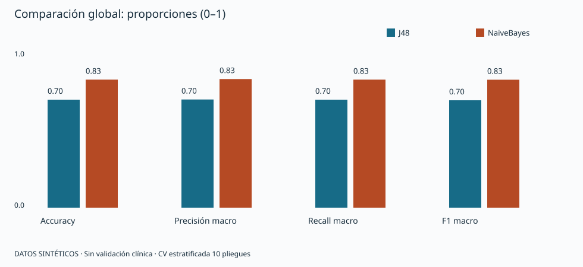
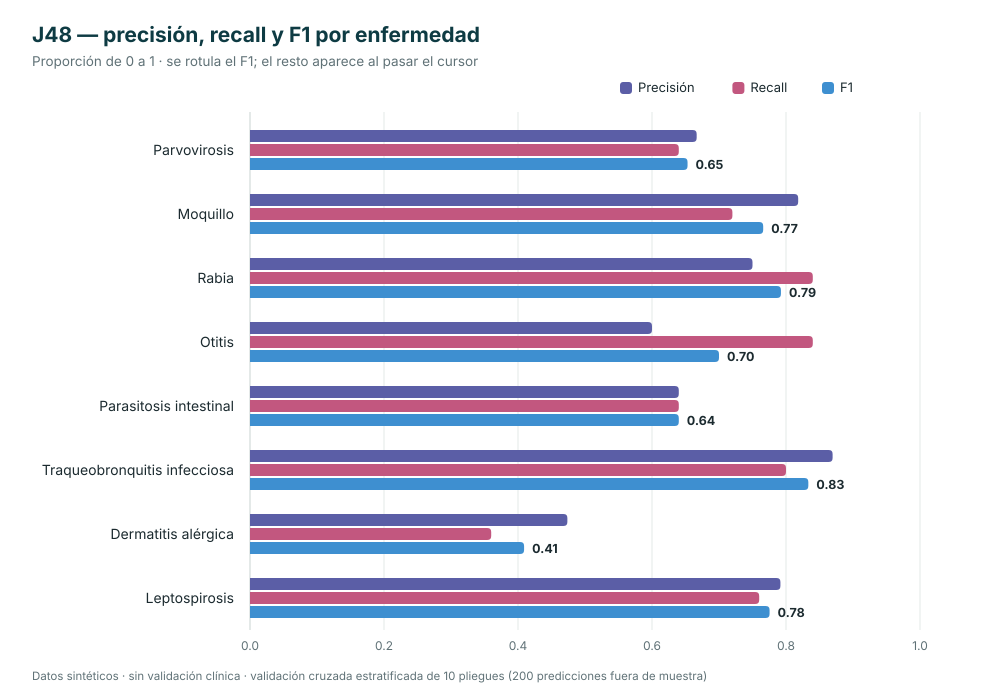
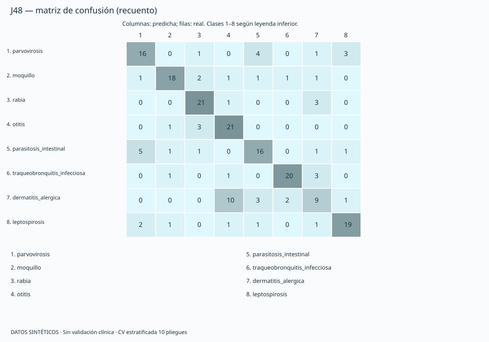
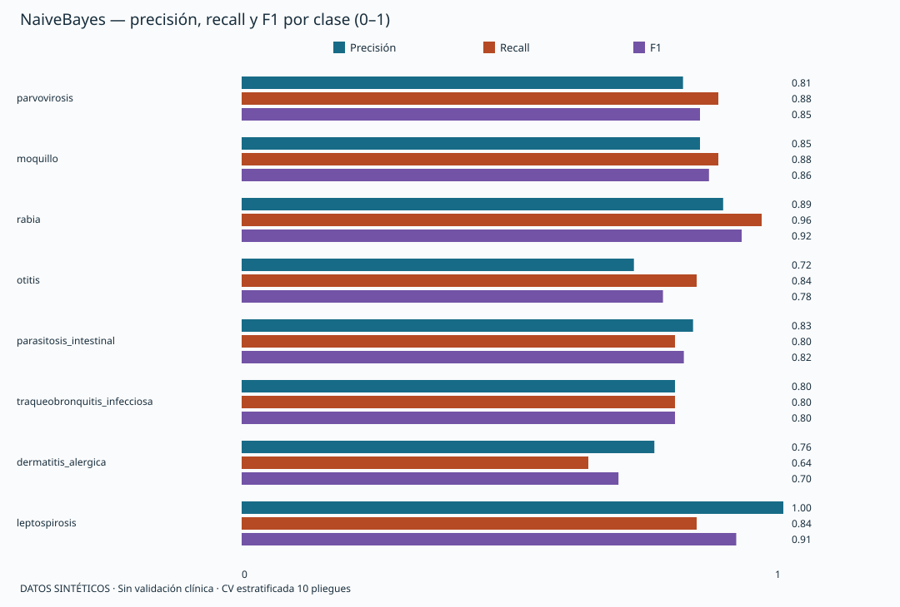
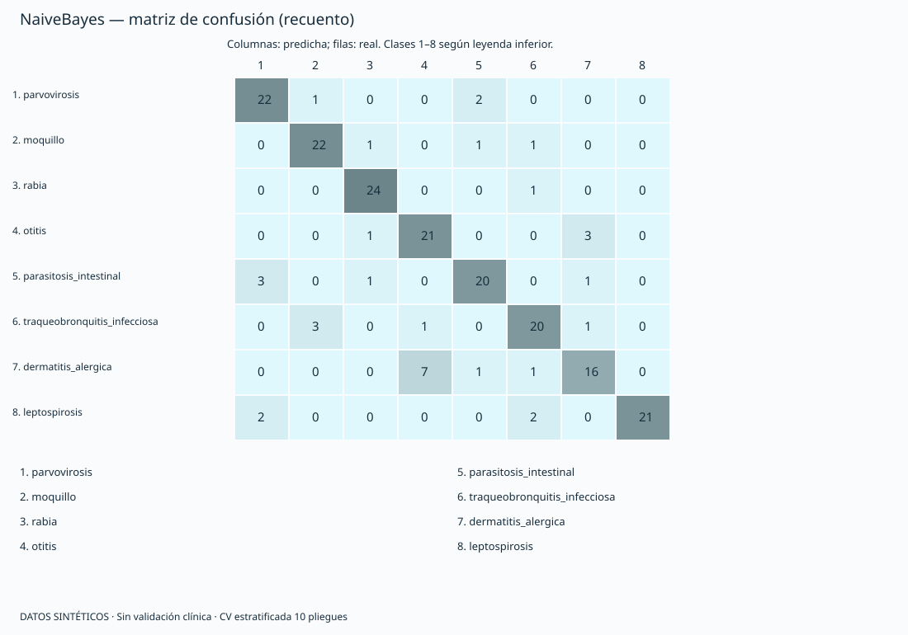

# Resultados ejecutados automáticamente

Weka 3.8.5; Java 21.0.8. Dataset: 200 filas. SHA-256: `64d2ba7e29beb5ecd88934640822fe1e964f72681d668e60d4e897b16a938924`.

CV estratificada de 10 pliegues, semilla 42, mismos pliegues para ambos modelos. No se ajustaron hiperparámetros con estos resultados. Las métricas por clase agrupan las 200 predicciones fuera de muestra. Métricas no definidas se registran NA en CSV y se tratan como 0 para macro.

Vectores de síntomas repetidos (exceso sobre únicos): 37. Los duplicados no se eliminan; pueden cruzar pliegues. No representan perros reales.

|Algoritmo|Accuracy|Precisión macro|Recall macro|F1 macro|F1 ponderado|
|---|---:|---:|---:|---:|---:|
|J48|0.700000|0.701221|0.700000|0.696176|0.696176|
|NaiveBayes|0.830000|0.833654|0.830000|0.829347|0.829347|

## J48

|Clase|Soporte|Precisión|Recall|F1|
|---|---:|---:|---:|---:|
|parvovirosis|25|0.666667|0.640000|0.653061|
|moquillo|25|0.818182|0.720000|0.765957|
|rabia|25|0.750000|0.840000|0.792453|
|otitis|25|0.600000|0.840000|0.700000|
|parasitosis_intestinal|25|0.640000|0.640000|0.640000|
|traqueobronquitis_infecciosa|25|0.869565|0.800000|0.833333|
|dermatitis_alergica|25|0.473684|0.360000|0.409091|
|leptospirosis|25|0.791667|0.760000|0.775510|

Matriz: filas reales, columnas predichas, orden de clases igual al ARFF.

|Real / predicha|parvovirosis|moquillo|rabia|otitis|parasitosis_intestinal|traqueobronquitis_infecciosa|dermatitis_alergica|leptospirosis|
|---|---:|---:|---:|---:|---:|---:|---:|---:|
|parvovirosis|16|0|1|0|4|0|1|3|
|moquillo|1|18|2|1|1|1|1|0|
|rabia|0|0|21|1|0|0|3|0|
|otitis|0|1|3|21|0|0|0|0|
|parasitosis_intestinal|5|1|1|0|16|0|1|1|
|traqueobronquitis_infecciosa|0|1|0|1|0|20|3|0|
|dermatitis_alergica|0|0|0|10|3|2|9|1|
|leptospirosis|2|1|0|1|1|0|1|19|

## NaiveBayes

|Clase|Soporte|Precisión|Recall|F1|
|---|---:|---:|---:|---:|
|parvovirosis|25|0.814815|0.880000|0.846154|
|moquillo|25|0.846154|0.880000|0.862745|
|rabia|25|0.888889|0.960000|0.923077|
|otitis|25|0.724138|0.840000|0.777778|
|parasitosis_intestinal|25|0.833333|0.800000|0.816327|
|traqueobronquitis_infecciosa|25|0.800000|0.800000|0.800000|
|dermatitis_alergica|25|0.761905|0.640000|0.695652|
|leptospirosis|25|1.000000|0.840000|0.913043|

Matriz: filas reales, columnas predichas, orden de clases igual al ARFF.

|Real / predicha|parvovirosis|moquillo|rabia|otitis|parasitosis_intestinal|traqueobronquitis_infecciosa|dermatitis_alergica|leptospirosis|
|---|---:|---:|---:|---:|---:|---:|---:|---:|
|parvovirosis|22|1|0|0|2|0|0|0|
|moquillo|0|22|1|0|1|1|0|0|
|rabia|0|0|24|0|0|1|0|0|
|otitis|0|0|1|21|0|0|3|0|
|parasitosis_intestinal|3|0|1|0|20|0|1|0|
|traqueobronquitis_infecciosa|0|3|0|1|0|20|1|0|
|dermatitis_alergica|0|0|0|7|1|1|16|0|
|leptospirosis|2|0|0|0|0|2|0|21|

